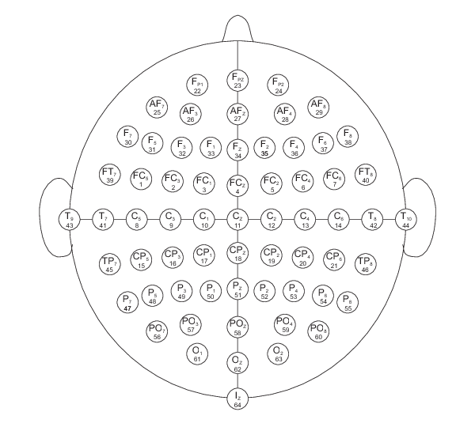

# Lab 2.1: The Fourier Transform and spectrograms {.unnumbered}

## Background

You are responsible for data vizualisation in a team of neuroimagery. 
In particular, your laboratory performs electroencephalograms (EEG) on human patients.

When performing and EEG, 64 electrodes are placed on the scalp of the patient according to the figure below. 
Each electrode records a voltage (in microvolts), induced by the brain activity. 
The sampling rate is 160 Hz, i.e., 160 measurements per second.

The file [`S089R03.csv`](../files/S089R03.csv) contains the EEG recording of a patient during a motor task. 

*Source: [Physionet, EEG Motor Movement/Imagery Dataset](https://physionet.org/content/eegmmidb/1.0.0/).*

## Part 1: The discrete Fourier transform

**Goal:** Recall the DFT.

1. For now, let us focus on the time series of sensor `Af7.`. 
   Using the script you created in the hands on of [this course](https://dls.hevs.ch/ts/week06), compute the DFT of the column `Af7.` from the EEG data. 

2. Plot the coefficient $c_k$ and $s_k$ of the DFT as functions of $k$.

## Part 2: The spectrogram

**Goal:** Build a spectrogram (interpretation will be left for next class).

The idea of a spectrogram is to compute the DFT of a signal on multiple, consecutive time intervals. 

3. Compute again the DFT of column `Af7.`, but only on the first 3001 time steps. 
   Only keep the coefficients $c_k$ for now. 

4. For the same column, compute the DFT for time steps from 500 to 3501. 
   And for time steps 1000 to 4001. 
   Repeat this process as many times as possible and store all the $c_k$ coefficents in a table. 
   At each repetition, you compute the DFT of a time series of length 3001 time steps and that starts 500 time steps after the previous one. 
   You should end up with a table with 1501 rows and 51 columns. 

5. Using the `contourf` function of `matplotlib.pyplot`, provide a graphical representation of the obtained table. 
   This is a spectrogram. 

*Remark: You may want to use the logarithm of the values in your table to emphasize the smaller values.*

6. The spectrogram built at the previous point represents three dimensions (x-axis, y-axis, color scale). 
   What should be the labels of these different dimensions?
   
7. Gather steps 3-5 into a script and represent the spectrograms for colums `Fp1.`, `Fp2.`, `Iz..`, `Oz..`, and `T8..`. 

*Remark: In the next class, we will see how to interpret the content of the DFT and of the spectrogram.*

