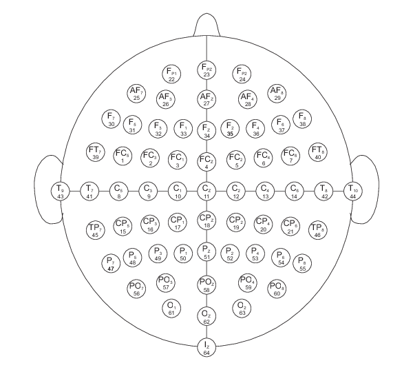

# Lab 3: Filters and thresholds {.unnumbered}

## Objective
Now that we know how to move a time series from time domain to frequency domain, we would like to be able to move it back to time domain. 
In this lab, we will:

1. See how to invert our DFT.
 
2. Explore the impact in time domain of manipulations in frequency domain.

## Background
Recall the EEG data of the [previous lab](https://dls.hevs.ch/ts/week08).

When performing and EEG, 64 electrodes are placed on the scalp of the patient according to the figure below. 
Each electrode records a voltage (in microvolts), induced by the brain activity. 
The sampling rate is 160 Hz, i.e., 160 measurements per second.

The file [`S089R03.csv`](../files/S089R03.csv) contains the EEG recording of a patient during a motor task. 

*Source: [Physionet, EEG Motor Movement/Imagery Dataset](https://physionet.org/content/eegmmidb/1.0.0/).*

## Part 1: The inverse Fourier transform

**Reminder:**
We defined the DFT (Discrete Fourier Transform) as the list of coefficients of the time series $X$, seen as a vector, in the Fourier basis $\left\{\vec{c}^{(0)}, \vec{c}^{(1)}, \vec{s}^{(1)}, \vec{c}^{(2)},\cdots, \vec{s}^{((N-1)/2)}\right\}$:
$$\vec{c}^{(k)}_i = \sqrt{\frac{2}{N}}\cos\left(\frac{2\pi i k}{N}\right) \\
\vec{s}^{(k)}_i = \sqrt{\frac{2}{N}}\sin\left(\frac{2\pi i k}{N}\right)\, ,$$
where $i=0,1,...,N-1$, and
$$\vec{c}^{(0)} = \left(\frac{1}{\sqrt{N}},\frac{1}{\sqrt{N}},\cdots,\frac{1}{\sqrt{N}}\right)\, .$$

In other words, it means that you can write the time series as a linear combination of the above vectors, using the values in the DFT,
$$X = c_0\vec{c}^{(0)} + \sum_{k=1}^{(N-1)/2} \left(c_k\vec{c}^{(k)} + s_k\vec{s}^{(k)}\right)\, .$$

This approach works on paper, but would be very inefficient to implement in code. 
Instead, as for our DFT, we will leverage the built-in inverse Fourier transform of Python. 

[This script](./my_IDFT.py) exactly reverses the process of the function `my_DFT` from [these hands on](https://dls.hevs.ch/ts/week06) and returns the original time series.

1. If needed, adapt this script so it reverses your own DFT from the cited hands on.

## Part 2: Filters
A **filter** acts in the frequency domain. 
Applying a filter to a Fourier spectrum boils down to cancelling some coefficients while keeping the other unchanged. 

2. Compute the DFT of the 3001 first recordings of sensor `Af7.`

3. [Low-pass filter] In this DFT, keep the 251 first coefficients unchanged and set all the others to zero. 
   Then compute the IDFT (inverse DFT) and plot both the original time series and the output of the IDFT on the same figure.
   What do you observe?

4. [High-pass filter] In the DFT again, keep the 1000 last coefficents unchanged and set all the other to zero. 
   Computing and plotting the IDFT, what do you observe now. 

5. [Band-pass filter] Identify now a peak half way in the spectrum. 
   Keep a narrow range of 100 coefficients aroung this peak unchanged and set all others to zero. 
   Again compute and plot the IDFT.

A filter selects a frequency range and isolates the contribution of these frequencies to the time series. 
The contribution of all other frequencies is discarded. 

## Part 3: Thresholding
A filter focuses on a chosen frequency range. 
Sometimes, we want to cover all the frequency spectrum, but only keep the terms of the DFT which contribute the most to the time series' shape.

In this case, we choose a threshold $\gamma$ and keep only the coefficients of the DFT whose magnitude is larger that $\gamma$ 
All other coefficients are set to zero.
Finally, the IDFT is computed to get back to time domain.

This **thresholding** will smoothen the signal but the contribution of all relevant frequencies.

6. In the same DFT as before, keep the 30 largest coefficients and set all others to zero. 
   Compute and plot the IDFT.

7. Repeat for the 100 largest coefficients. For the 300 largest coefficients. For the 1000 largest coefficients. 

## Solution coming soon...
<!-- ## [Solution](../solutions/week11-solution.ipynb)-->

